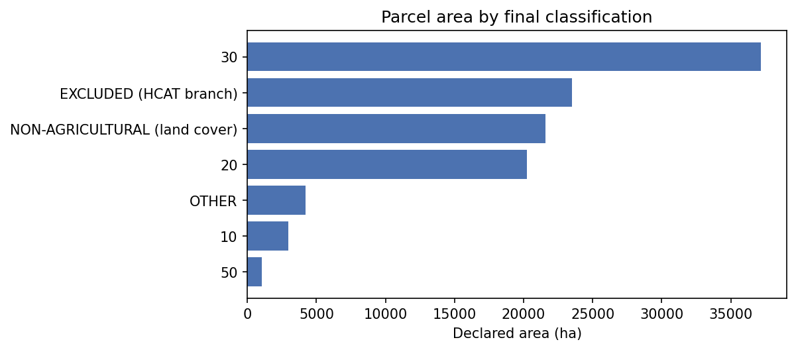
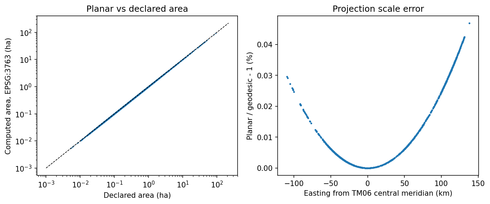
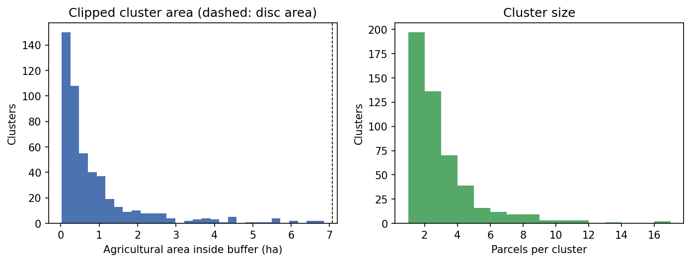
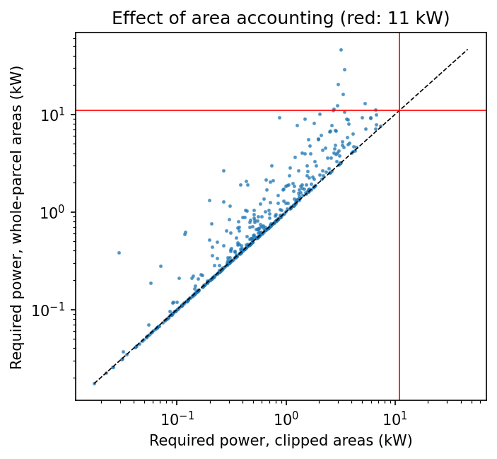
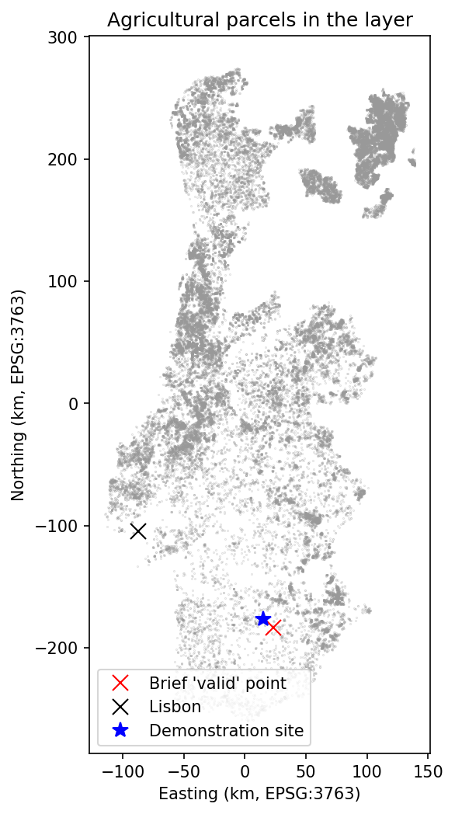
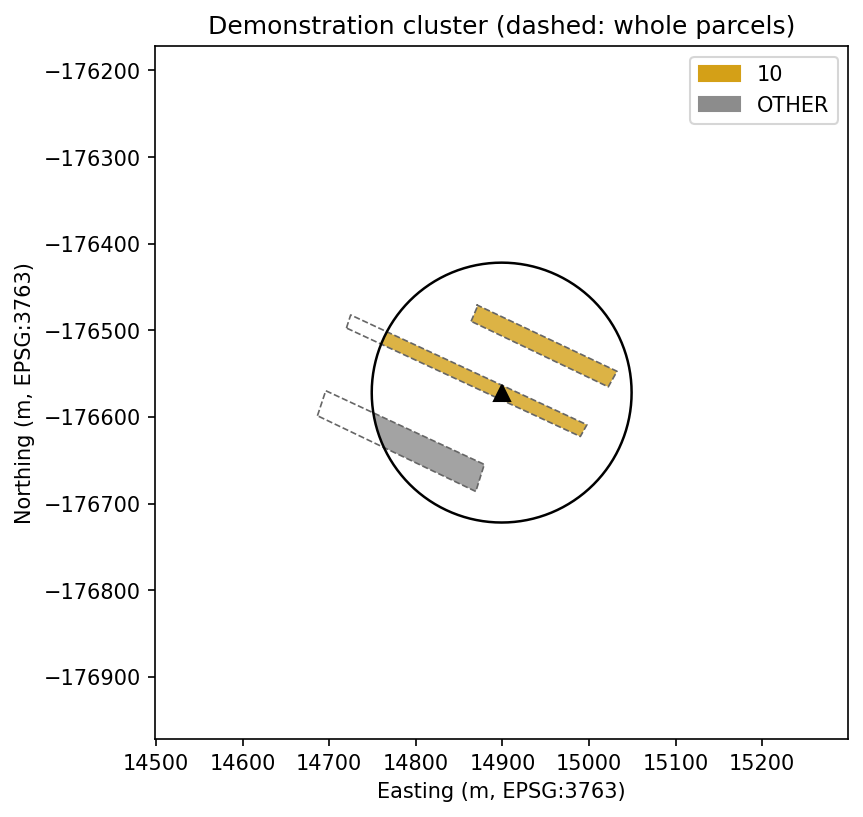
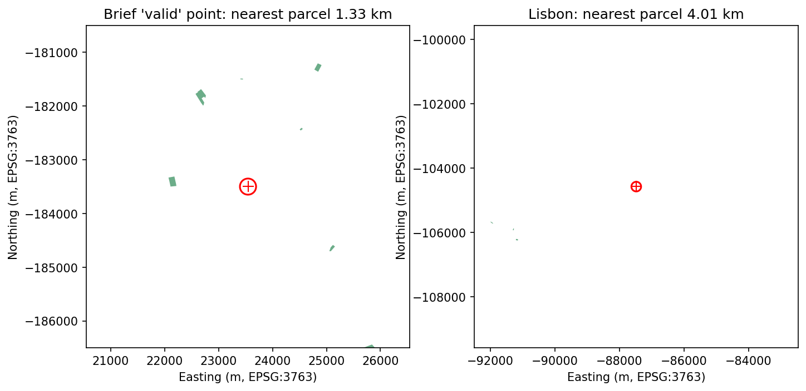

# Task 1 evaluation: spatial ingestion and clustering

Copyright (c) 2026 Hao Ni. All rights reserved.

This report verifies the parcel ingestion and clustering engine (`dss.spatial`, `dss.taxonomy`) against the supplied EuroCrops Portugal layer: classification coverage, geometric accuracy, robustness over random locations, performance, and sensitivity to the two Task 1 modelling choices (area accounting and buffer radius).

**Checks passed: 13 / 13**

| Check | Result | Detail |
|---|---|---|
| Every HCAT code matches an explicit mapping rule | PASS | 79 distinct codes; unmatched: none |
| Every retained parcel has a crop archetype | PASS | 67,726 agricultural parcels retained |
| Label overrides changed only the targeted parcels | PASS | 308 parcels re-assigned by 4 overrides |
| Planar areas agree with declared areas | PASS | median \|error\| = 0.009% (threshold 1 %) |
| Planar areas agree with geodesic areas | PASS | P99 \|error\| = 0.0409% (threshold 0.5 %) |
| Buffer polygon approximates the 150 m disc | PASS | area error -0.0402% with 128 vertices |
| Cluster extraction well under a few seconds | PASS | P95 query time 3.1 ms |
| No unexpected exception over random locations | PASS | 1000 runs; unexpected errors: 0 |
| Every point inside a parcel yields a cluster | PASS | 500 / 500 parcel points succeeded |
| Geometric invariants hold for every cluster | PASS | clipped area > buffer area: 0, clipped area > whole-parcel area: 0, centroid outside buffer: 0, empty cluster returned: 0 |
| Clipped demand never exceeds the physical maximum of the disc | PASS | max 7.37 kW <= 12.84 kW (disc fully planted with vegetables) |
| Lisbon raises EmptyClusterError | PASS | outcome: empty |
| A demonstration site is found near the brief's point | PASS | (38.07759, -7.96330), 11.1 km away |

## 1. Classification coverage and label audit

**What.** Every parcel is classified from its 10-digit HCAT code by longest-prefix
match (`resources/hcat_mapping.csv`), corrected by a small table of documented
EuroCrops harmonisation errors (`resources/label_overrides.csv`), and kept only
if its national land-cover class is agricultural.

| Status | Parcels | Area (ha) | Share of area |
|---|---|---|---|
| 10 | 6,464 | 2,973 | 2.7% |
| 20 | 31,232 | 20,223 | 18.3% |
| 30 | 21,047 | 37,190 | 33.6% |
| 50 | 3,001 | 1,050 | 0.9% |
| EXCLUDED (HCAT branch) | 4,092 | 23,524 | 21.2% |
| NON-AGRICULTURAL (land cover) | 28,182 | 21,590 | 19.5% |
| OTHER | 5,982 | 4,191 | 3.8% |

*Area by final status.*

**Overrides applied** (each matches both the HCAT code and the national label):

| HCAT code | National label | New category | Parcels | Area (ha) |
|---|---|---|---|---|
| 3303030000 | PINHÃO | EXCLUDED (HCAT branch) | 279 | 3,190 |
| 3302000000 | MEDRONHO | 20 | 8 | 10.81 |
| 3301070000 | OUTRAS LEGUMINOSAS SECAS | OTHER | 19 | 3.657 |
| 3303030000 | AMENDOIM | OTHER | 2 | 26.17 |

**Full audit.** Every combination of HCAT code, national label, land cover and
assigned category, with parcel counts and areas, is listed in [`hcat_label_audit.csv`](hcat_label_audit.csv). All
combinations were reviewed manually; apart from the overridden labels, the
EuroCrops assignment is consistent with the national label. About 0.5 % of
parcels carry several crops (e.g. `MILHO;BATATA`); EuroCrops harmonises only
the first one, which this engine inherits.

## 2. Geometric accuracy

**What.** Areas are computed in ETRS89 / Portugal TM06 (EPSG:3763). They are
checked against (i) the areas declared in the source data and (ii) an
independent geodesic computation on the GRS80 ellipsoid (`pyproj.Geod`), which
does not depend on any map projection.

| Comparison | n | Median |error| | P95 |error| | Share > 5 % |
|---|---|---|---|---|
| Planar vs declared (all parcels) | 67,726 | 0.009% | 0.085% | 0.00% |
| Planar vs geodesic (1,000 sampled parcels) | 1,000 | 0.0072% | 0.0361% | 0.00% |

*Left: computed vs declared area. Right: planar vs geodesic area; the error grows with distance from the TM06 central meridian, as expected for a transverse Mercator projection.*

Largest disagreements with the declared area. Only 1 parcel(s) differ
by more than 1 %; the remaining differences above 0.5 % occur on very small
parcels (median declared area 64 m2), consistent with declared
areas being rounded to whole square metres.

| hcat_name | declared_area_ha | area_full_ha | rel_error |
|---|---|---|---|
| potatoes | 0.0834 | 0.1144 | +37.1% |
| fresh_vegetables | 0.0051 | 0.005146 | +0.9% |
| olive_plantations | 0.0052 | 0.005246 | +0.9% |
| pasture_meadow_grassland_grass | 0.0053 | 0.005255 | -0.9% |
| pasture_meadow_grassland_grass | 0.0054 | 0.005446 | +0.8% |
| olive_plantations | 0.0054 | 0.005357 | -0.8% |
| other_arable_land_crops | 0.0065 | 0.00645 | -0.8% |
| temporary_grass | 0.0059 | 0.005855 | -0.8% |
| permanent_crops_perennial | 0.0054 | 0.00544 | +0.7% |
| temporary_grass | 0.0064 | 0.006447 | +0.7% |

The buffer polygon (128 vertices) under-estimates the exact disc area by
0.040%.

## 3. Performance

The layer is loaded once; each query uses the R-tree spatial index
(`GeoDataFrame.sindex.query`) to pre-select candidates before the exact
intersection test.

| Step | Time |
|---|---|
| Read PT.zip (4 attributes) | 1.8 s |
| Prepare layer (reproject, classify, index) | 2.0 s |
| Cluster query (n = 200) | median 2.4 ms, P95 3.1 ms, max 4.0 ms |

## 4. Robustness over random locations

**What.** Two random samples (seed 20261027): points placed inside randomly chosen
agricultural parcels (every query must succeed) and points drawn uniformly over
the mainland bounding box (many fall in the sea, in Spain or far from any parcel
of this sparse layer, and must raise `EmptyClusterError`). Every successful
cluster is checked against geometric invariants.

| sample | empty | ok |
|---|---|---|
| parcel points | 0 | 500 |
| random mainland points | 485 | 15 |

| sample | n_parcels mean | n_parcels 50% | n_parcels max | area_clipped_ha mean | area_clipped_ha 50% | area_clipped_ha max |
|---|---|---|---|---|---|---|
| parcel points | 2.514 | 2 | 16 | 0.9113 | 0.448 | 6.86 |
| random mainland points | 1.267 | 1 | 3 | 1.009 | 0.1717 | 7.066 |

*Distribution over parcel points.*

Per-run results: [`robustness_runs.csv`](robustness_runs.csv).

## 5. Area accounting: clipped vs whole parcel

Headline results use the area inside the buffer (areal weighting). Counting
whole parcels instead would attribute land far outside a 150 m command zone to
a single tube well:

| Statistic | Value |
|---|---|
| Whole / clipped area, median | 1.01 |
| Whole / clipped area, P90 | 2.37 |
| Clusters needing > 11 kW (clipped) | 0.0% |
| Clusters needing > 11 kW (whole parcel) | 1.8% |
| Max required power, clipped (kW) | 7.37 |

*Clipped vs whole-parcel power.*

## 6. Sensitivity to the buffer radius

The same 200 locations, re-run with `ParcelLayer.with_config` (the
prepared layer and its index are reused):

| Radius (m) | Disc (ha) | Mean parcels | Mean clipped area (ha) | Mean fill of disc | Mean power (kW) | Share > 11 kW |
|---|---|---|---|---|---|---|
| 100 | 3.14 | 2 | 0.59 | 19% | 0.62 | 0.0% |
| 150 | 7.07 | 2.62 | 0.87 | 12% | 0.89 | 0.0% |
| 200 | 12.57 | 3.38 | 1.14 | 9% | 1.16 | 0.0% |

Clipped area, and therefore demand and pump power, scale roughly with the disc
area (radius squared), moderated by how much of the disc is farmland.

## 7. Brief locations and demonstration site

| Location | lat, lon | Outcome | Nearest agricultural parcel |
|---|---|---|---|
| Brief 'valid' point (Alentejo) | 38.015, -7.865 | empty | 1.33 km |
| Brief urban point (Lisbon) | 38.722, -9.139 | empty | 4.01 km |

The brief's 'valid' Alentejo point has no parcel within 150 m: the supplied layer
is a sparse subset (100,000 polygons, `OSA_ID` up to ~2.08 million), so it is
expected to raise `EmptyClusterError`.

**Demonstration site, selected by rule rather than by hand.** Candidate wells
are placed at a point inside each agricultural parcel within
30 km of the brief's point, ordered by distance; the first
cluster with at least 3 parcels and 2 crop archetypes is selected (so that the
demonstration exercises mixed water demand and PUE crop compatibility). The
nearest cluster of any composition lies 1.40 km away;
66 candidates were evaluated.

| Item | Value |
|---|---|
| Well location (lat, lon) | 38.07759, -7.96330 |
| Distance from brief point | 11.08 km |
| Parcels | 3 |
| Cluster centroid (lat, lon) | 38.07754, -7.96355 |

| Category | Clipped area (ha) | Whole-parcel area (ha) |
|---|---|---|
| 10 | 0.754 | 0.825 |
| OTHER | 0.414 | 0.633 |

## 8. Maps

*Sparse national coverage.*

*Clipped parcels by crop archetype inside the 150 m buffer.*

*Surroundings of the brief's points (red: 150 m buffer; green: agricultural parcels).*

## Reproducibility

| Item | Value |
|---|---|
| Generated (UTC) | 2026-10-28 10:58 |
| Python | 3.10.12 |
| Platform | Linux-6.8.0-106-generic-x86_64-with-glibc2.35 |
| Git commit | ef2eb1b |
| Random seed | 20261027 |
| geopandas | 1.1.4 |
| shapely | 2.1.2 |
| pyproj | 3.7.1 |
| pyogrio | 0.13.0 |
| pandas | 2.3.3 |
| numpy | 2.2.6 |
| requests | 2.34.2 |
| matplotlib | 3.10.9 |
| MD5 PT.zip | 3dba9c89c559b34d57acd286505bcb66 |
