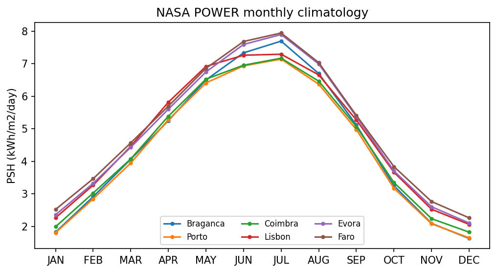
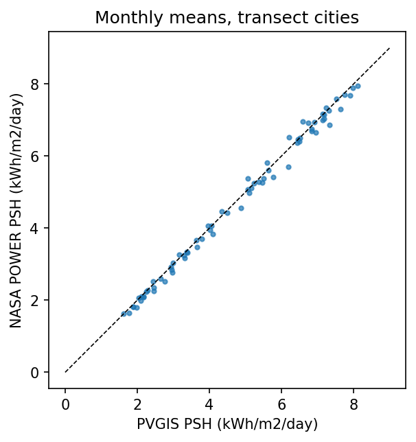
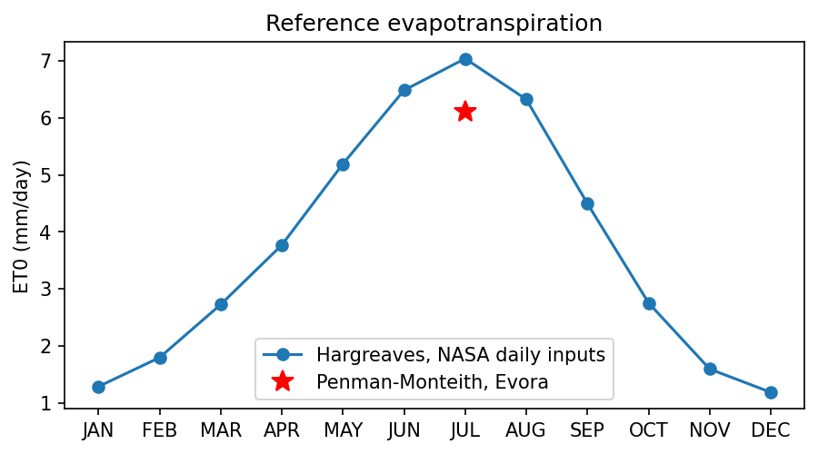
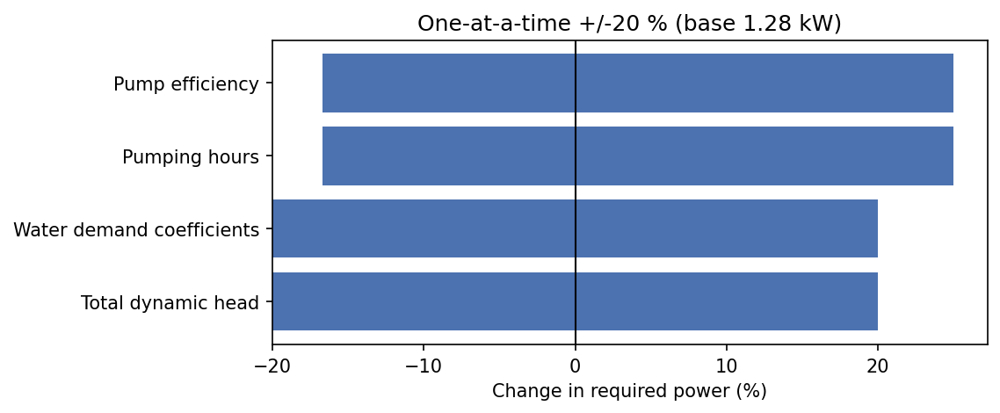

# Task 2 evaluation: solar resource, water demand and pump power

Copyright (c) 2026 Hao Ni. All rights reserved.

This report verifies the NASA POWER client (`dss.solar`) and the hydraulic sizing (`dss.hydraulics`): live data retrieval and unit handling, spatial plausibility, an independent cross-check against PVGIS, agronomic plausibility of the brief's water-demand coefficients, an independent recomputation of the pump power, the consistency of the brief's pump catalogue, parameter sensitivity, and error handling.

**Checks passed: 7 / 7**

| Check | Result | Detail |
|---|---|---|
| Live data come from the API, not a cache or file | PASS | sources: api, api |
| Unit conversion follows the response metadata | PASS | API units 'MJ/m^2/day'; raw ANN 17.65 -> 4.903 kWh/m2/day |
| Live API reproduces the stored response | PASS | max monthly difference 0.0000 kWh/m2/day |
| Irradiance increases towards the south | PASS | Spearman rank correlation (latitude, annual PSH) = -0.83 |
| NASA POWER agrees with PVGIS within 10 % (annual) | PASS | annual biases between -5.1% and +1.8% |
| Engine reproduces the hand calculation | PASS | Q = 38.846 m3/day, P = 1.283 kW |
| Failure modes handled as designed (live) | PASS | 6 / 6 scenarios |

## 1. Live NASA POWER retrieval

Each cluster is queried at its own centroid (38.07754, -7.96355 for the
demonstration site). The API reports units of **MJ/m^2/day** for `community=AG`, so
values are divided by 3.6 to obtain kWh/m2/day (peak sun hours). The design
month is the minimum month at each location: **DEC**
(2.11 PSH) at the demonstration site.

The irradiance source reported by the API is **SYN1DEG**, a 1-degree global
grid, so points in the same grid cell receive identical values. The demonstration site and the brief's point fall in the same cell, which is why their values below are identical; both were fetched live.

| Month | Demo centroid PSH (kWh/m2/day) | Brief point PSH, live | Brief point PSH, stored fixture |
|---|---|---|---|
| JAN | 2.358 | 2.358 | 2.358 |
| FEB | 3.325 | 3.325 | 3.325 |
| MAR | 4.433 | 4.433 | 4.433 |
| APR | 5.606 | 5.606 | 5.606 |
| MAY | 6.75 | 6.75 | 6.75 |
| JUN | 7.594 | 7.594 | 7.594 |
| JUL | 7.9 | 7.9 | 7.9 |
| AUG | 6.994 | 6.994 | 6.994 |
| SEP | 5.378 | 5.378 | 5.378 |
| OCT | 3.706 | 3.706 | 3.706 |
| NOV | 2.606 | 2.606 | 2.606 |
| DEC | 2.106 | 2.106 | 2.106 |
| ANN | 4.903 | 4.903 | 4.903 |

## 2. Spatial plausibility: north-south transect

| City | Latitude | Annual PSH | Design month | Design PSH | July PSH |
|---|---|---|---|---|---|
| Braganca | 41.81 | 4.542 | DEC | 1.631 | 7.697 |
| Porto | 41.15 | 4.394 | DEC | 1.65 | 7.144 |
| Coimbra | 40.2 | 4.514 | DEC | 1.825 | 7.172 |
| Lisbon | 38.72 | 4.797 | DEC | 2.064 | 7.294 |
| Evora | 38.57 | 4.903 | DEC | 2.106 | 7.9 |
| Faro | 37.02 | 5.014 | DEC | 2.264 | 7.947 |

*Monthly PSH, north to south.*

Annual irradiance rises from north to south, with one expected exception:
inland Braganca receives more than coastal Porto, where Atlantic cloud cover is
more frequent.

## 3. Independent cross-check against PVGIS

PVGIS (EU Joint Research Centre, satellite-derived) is an independent source of
global horizontal irradiation. Its monthly totals (`MRcalc`, `H(h)_m`, kWh/m2 per
month) are converted to mean daily values and averaged over all available years.
Satellite products typically differ from ground measurements by a few per cent
on an annual basis, so agreement within 10 % is the acceptance threshold.

| City | NASA annual PSH | PVGIS annual PSH | Annual bias (NASA/PVGIS - 1) | Monthly MAPE |
|---|---|---|---|---|
| Braganca | 4.542 | 4.564 | -0.5% | 1.0% |
| Porto | 4.394 | 4.485 | -2.0% | 3.1% |
| Coimbra | 4.514 | 4.433 | +1.8% | 2.7% |
| Lisbon | 4.797 | 4.813 | -0.3% | 2.6% |
| Evora | 4.903 | 4.972 | -1.4% | 1.8% |
| Faro | 5.014 | 5.284 | -5.1% | 5.7% |

*NASA POWER vs PVGIS.*

## 4. Agronomic plausibility of the brief's water demand (finding)

**Benchmark.** Peak (July) reference evapotranspiration computed with FAO
Penman-Monteith from station data at Evora, 55 km from the
demonstration site, is 6.1 mm/day (Rodrigues & Braga, 2021,
*Agriculture* 11(2), 124; 5.7-7.3 mm/day across 14 Alentejo stations).
Peak crop evapotranspiration is `ETc = Kc_mid x ET0` with FAO-56 mid-season
coefficients. July rainfall is negligible, so ETc approximates the net irrigation
requirement; the gross requirement is larger once application losses are
included.

| Archetype | FAO-56 reference crop | Kc mid | Peak ETc, Evora PM (mm/day) | Peak ETc, NASA Hargreaves (mm/day) | Brief demand (mm/day) | Brief / ETc (Evora PM) |
|---|---|---|---|---|---|---|
| 10 | maize (grain) | 1.2 | 7.32 | 8.45 | 3.5 | 48% |
| 20 | olives, 40-60 % ground cover | 0.7 | 4.27 | 4.93 | 4.5 | 105% |
| 30 | rotated grazing pasture (0.85-1.05) | 0.95 | 5.79 | 6.69 | 1.5 | 26% |
| 50 | tomato | 1.15 | 7.01 | 8.09 | 5.5 | 78% |
| OTHER | dry beans | 1.15 | 7.01 | 8.09 | 3 | 43% |

**Finding.** The brief's coefficients are below 70 % of FAO-56 peak demand for
archetypes 10, 30, OTHER and at or above 70 % for 20, 50; low values
are better read as season-average or deficit-irrigation figures. Headline results
keep the brief's values (comparability across candidates); this comparison bounds
the uncertainty and motivates the Monte Carlo extension.

**Secondary estimate.** ET0 is computed for every day of 2001-2020
with the Hargreaves equation (FAO-56, eq. 52) from NASA POWER *daily*
`T2M_MAX`, `T2M_MIN` and `T2M`, and extraterrestrial radiation from FAO-56
eq. 21, then averaged by month. It gives 7.0 mm/day in
JUL, +15% relative to the station benchmark. Hargreaves is known
to over-estimate Penman-Monteith in Alentejo by 0-23 % (regional slope 1.08; same
source), which lies within that documented range.

Why daily data: NASA documents `T2M_MAX_AVG` as the average of the daily maximum temperature. At this site, however, the climatology endpoint returns 41.4 C for July (`T2M_MAX`: 45.1 C), whereas the mean of NASA's own daily maxima for 2001-2020 is 34.9 C. The cause of this difference is not documented, so ET0 is computed from the daily series, which matches the definition required by the Hargreaves equation.

| Month | Mean daily Tmax (C) | Mean daily Tmin (C) | Mean T (C) | Ra, FAO-56 (MJ/m2/day) | ET0 Hargreaves (mm/day) |
|---|---|---|---|---|---|
| JAN | 14.8 | 4.9 | 9.1 | 16.5 | 1.28 |
| FEB | 15.8 | 5.2 | 9.9 | 21.5 | 1.79 |
| MAR | 18.6 | 6.9 | 12.3 | 28.4 | 2.72 |
| APR | 21.2 | 8.9 | 14.7 | 35.2 | 3.77 |
| MAY | 26.1 | 11.6 | 18.6 | 39.9 | 5.19 |
| JUN | 31.5 | 15 | 23 | 41.7 | 6.48 |
| JUL | 34.9 | 16.5 | 25.3 | 40.6 | 7.04 |
| AUG | 35.1 | 17.3 | 25.7 | 36.7 | 6.32 |
| SEP | 31 | 16 | 22.8 | 30.4 | 4.5 |
| OCT | 25.1 | 13 | 18.3 | 23.3 | 2.75 |
| NOV | 18.6 | 8.2 | 12.7 | 17.4 | 1.59 |
| DEC | 15.4 | 5.6 | 9.7 | 14.9 | 1.18 |

*Monthly ET0 at the demonstration site.*

## 5. Independent recomputation for the demonstration cluster

| Archetype | Area (ha) | Demand coefficient (m3/ha/day) | Demand (m3/day) |
|---|---|---|---|
| 10 | 0.7545 | 35 | 26.41 |
| OTHER | 0.4146 | 30 | 12.44 |

Unit trail (the brief's "hydraulic power" includes the efficiency, so it is the
electrical input power the motor must deliver):

| Quantity | Value | Unit |
|---|---|---|
| Irrigated area | 1.169 | ha |
| Daily demand Q_day | 38.85 | m3/day |
| Flow over 6 h | 6.474 | m3/h |
| Hydraulic work rho*g*Q*H | 15,243,184 | J/day |
| Hydraulic energy | 4.234 | kWh/day |
| Hydraulic (output) power | 0.7057 | kW |
| Electrical (input) power / eta | 1.283 | kW |

## 6. Consistency of the brief's pump catalogue (finding)

Lifting 1 m3 by 40 m requires 0.1090 kWh of hydraulic energy. The
catalogue's "max delivery at 40 m" is 2.2-2.6 times what the brief's own formula
gives for the rated motor power, and would require 13-15 kWh/m2/day of
irradiation with the brief's efficiency and derate, more than the clear-sky
maximum at the Earth's surface. The figures are consistent with a head of only
about 16-18 m, and exceed the SECI minimum-output benchmark (interpolated to
30.5 L/Wp/day at 40 m, under 7.15 kWh/m2/day with tracking) by a factor
of about 1.7-1.9.

| Tier | Motor (kW) | PV (kWp) | Catalogue (m3/day) | Brief formula (m3/day) | Ratio | Implied head at eta 0.55, 6 h (m) | PSH needed, 100 % conversion | PSH needed, eta 0.55 and derate 0.75 | SECI benchmark at 40 m (m3/day) |
|---|---|---|---|---|---|---|---|---|---|
| Tier 1 | 3.7 | 5 | 250 | 112 | 2.23 | 17.9 | 5.45 | 13.2 | 152 |
| Tier 2 | 5.5 | 7.5 | 400 | 166.5 | 2.4 | 16.7 | 5.81 | 14.1 | 229 |
| Tier 3 | 7.5 | 10 | 580 | 227.1 | 2.55 | 15.7 | 6.32 | 15.3 | 305 |
| Tier 4 | 11 | 15 | 850 | 333 | 2.55 | 15.7 | 6.18 | 15 | 458 |

**Consequence.** The column is not used for selection (the brief selects by
motor power); it is used only to flag clusters whose demand exceeds the
catalogue figure.

## 7. Sensitivity of the required power

Required power is proportional to head and demand and inversely proportional to
efficiency and pumping hours, so +/-20 % on any input moves it by -17 % to +25 %.
Whether a cluster crosses the single-pump limit (11 kW) can therefore depend on
input uncertainty; this is the natural target of a Monte Carlo analysis.

| Input | -20 % | +20 % | Span (kW) |
|---|---|---|---|
| Total dynamic head | 1.026 | 1.54 | 0.5132 |
| Water demand coefficients | 1.026 | 1.54 | 0.5132 |
| Pumping hours | 1.604 | 1.069 | 0.5346 |
| Pump efficiency | 1.604 | 1.069 | 0.5346 |

*Sensitivity of the required power.*

## 8. Error handling against the live service

Unit tests cover these paths with a fake HTTP session; here they are exercised
against the real network stack.

| Scenario | Expected | Observed | Result |
|---|---|---|---|
| Latitude 95 (invalid) | DataValidationError | DataValidationError | PASS |
| Unknown endpoint (HTTP 4xx, not retried) | SolarDataError | SolarDataError: NASA POWER returned HTTP 404. | PASS |
| Unreachable host (retried once) | SolarDataError | SolarDataError: NASA POWER request failed: HTTPSConnectionPool(host='power.invalid', port=443): Max  | PASS |
| 1 ms timeout (retried once) | SolarDataError | SolarDataError: NASA POWER request failed: HTTPSConnectionPool(host='power.larc.nasa.gov', port=443) | PASS |
| Populate disk cache | returned (source: api) | returned (source: api) | PASS |
| Service down, disk cache present | returned (source: disk-cache) | returned (source: disk-cache) | PASS |

## Reproducibility

| Item | Value |
|---|---|
| Generated (UTC) | 2026-10-27 18:24 |
| Python | 3.10.12 |
| Platform | Linux-6.8.0-106-generic-x86_64-with-glibc2.35 |
| Git commit | eef0ef2 |
| Random seed | 20261027 |
| geopandas | 1.1.4 |
| shapely | 2.1.2 |
| pyproj | 3.7.1 |
| pyogrio | 0.13.0 |
| pandas | 2.3.3 |
| numpy | 2.2.6 |
| requests | 2.34.2 |
| matplotlib | 3.10.9 |
| MD5 nasa_power_alentejo.json | 9c5b276825e8dc5567610f1d97b03e09 |
