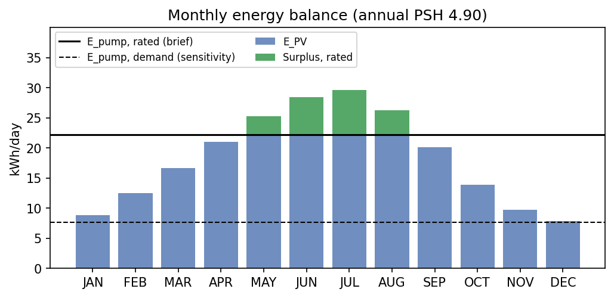
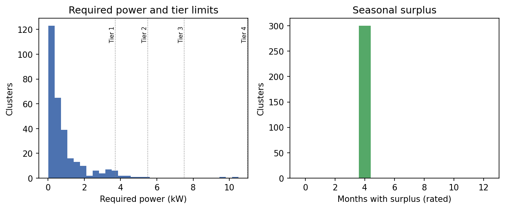
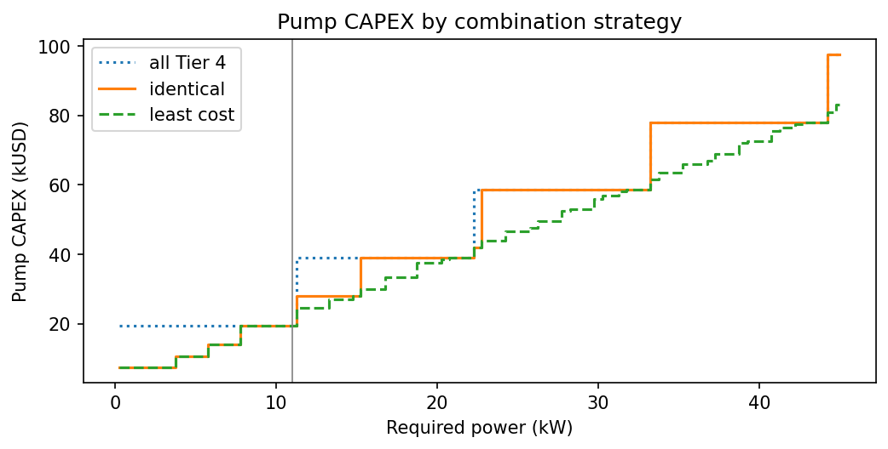

# Task 3 evaluation: pump selection and energy balance

Copyright (c) 2026 Hao Ni. All rights reserved.

This report verifies pump selection and the daily energy balance (`dss.energy`): an independent recomputation for the demonstration cluster, the analytical surplus threshold, a batch run over randomly placed wells, the multiple-pump strategies, and parameter sensitivity. Headline results use the brief's formula (rated motor power); the demand-based consumption and the monthly analysis are reported alongside as sensitivity and seasonal analyses.

**Checks passed: 5 / 5**

| Check | Result | Detail |
|---|---|---|
| Engine reproduces the hand calculation (annual PSH) | PASS | 1 x Tier 1; E_PV 18.39, surplus rated 0.00 / demand 10.69 kWh/day |
| Selected motor power covers the required power | PASS | 3.7 kW installed for 1.28 kW required |
| Analytical threshold separates deficit from surplus | PASS | threshold 5.87-6.00 PSH for all tiers |
| Invariants hold for every cluster and month | PASS | 300 clusters x 12 months x 2 bases; 0 violations |
| CAPEX ordering: least cost <= identical <= all Tier 4 | PASS | 180 power levels, 0.25-45 kW |

## 1. Demonstration cluster

Cluster centroid (38.07754, -7.96355);
irradiance source: api.

| Quantity | Value | Unit |
|---|---|---|
| Daily demand Q_day | 38.85 | m3/day |
| Required power P_req | 1.283 | kW |
| Selected pumps | 1 x Tier 1 |  |
| Motor power | 3.7 | kW |
| PV capacity | 5 | kWp |
| CAPEX | 7,500 | USD |
| Annual PSH | 4.903 | kWh/m2/day |
| E_PV = PV x PSH x derate | 18.385 | kWh/day |
| E_pump, rated (brief) | 22.200 | kWh/day |
| E_excess, rated (brief) | 0.000 | kWh/day |
| E_pump, demand (sensitivity) | 7.699 | kWh/day |
| E_excess, demand (sensitivity) | 10.687 | kWh/day |

**Headline (brief).** With the annual PSH of 4.90, PV
generation (18.4 kWh/day) is below the rated consumption
(22.2 kWh/day), so the surplus is
**0.0 kWh/day**.

**Seasonal analysis.** A surplus exists when the monthly PSH exceeds
5.92: in 4 months
(MAY, JUN, JUL, AUG).

**Demand-based consumption (sensitivity).** The pump runs at the rated power
only if it must; lifting the actual demand needs 7.7 kWh/day,
leaving 10.7 kWh/day on an annual basis.

| Month | PSH | E_PV (kWh/day) | Surplus, rated | Surplus, demand |
|---|---|---|---|---|
| JAN | 2.358 | 8.844 | 0 | 1.145 |
| FEB | 3.325 | 12.47 | 0 | 4.77 |
| MAR | 4.433 | 16.62 | 0 | 8.926 |
| APR | 5.606 | 21.02 | 0 | 13.32 |
| MAY | 6.75 | 25.31 | 3.113 | 17.61 |
| JUN | 7.594 | 28.48 | 6.279 | 20.78 |
| JUL | 7.9 | 29.62 | 7.425 | 21.93 |
| AUG | 6.994 | 26.23 | 4.029 | 18.53 |
| SEP | 5.378 | 20.17 | 0 | 12.47 |
| OCT | 3.706 | 13.9 | 0 | 6.197 |
| NOV | 2.606 | 9.771 | 0 | 2.072 |
| DEC | 2.106 | 7.896 | 0 | 0.1973 |

*Monthly PV generation against pump consumption.*

## 2. Analytical surplus threshold

With the rated consumption, `E_PV > E_pump` exactly when

    PSH > (t_pump / derate) x (P_motor / PV_kWp) = 8 x P_motor / PV_kWp

The threshold therefore depends only on the catalogue's PV-to-motor ratio, not on
the crops or the location: it is 5.87-6.00 PSH for every tier.

| Tier | Motor (kW) | PV (kWp) | PV / motor (kWp/kW) | Threshold PSH, rated |
|---|---|---|---|---|
| Tier 1 | 3.7 | 5 | 1.351 | 5.92 |
| Tier 2 | 5.5 | 7.5 | 1.364 | 5.867 |
| Tier 3 | 7.5 | 10 | 1.333 | 6 |
| Tier 4 | 11 | 15 | 1.364 | 5.867 |

Along the north-south transect the highest annual mean is 5.01 PSH, below the lowest threshold. **Under the brief's formula and annual PSH, no location on the transect has a surplus**; surpluses appear only in the summer months (seasonal analysis) or with demand-based consumption.

| City | Annual PSH | Max monthly PSH | Months above 5.87 |
|---|---|---|---|
| Braganca | 4.542 | 7.697 | 4 |
| Porto | 4.394 | 7.144 | 4 |
| Coimbra | 4.514 | 7.172 | 4 |
| Lisbon | 4.797 | 7.294 | 4 |
| Evora | 4.903 | 7.9 | 4 |
| Faro | 5.014 | 7.947 | 4 |

## 3. Batch run over random wells

Wells were placed at 300 random agricultural parcels (seed 20261027) and
the full chain was run: cluster, demand and power, NASA POWER at the centroid,
pump selection, monthly energy balance. Because the solar data come from a
1-degree grid, requests were grouped by grid cell; each group was verified by
fetching its extreme members (north, south, east, west) and fell back to
per-centroid requests if they differed (15 cells,
0 with differing extremes, 48
requests in total). Per-cluster results: [`batch_clusters.csv`](batch_clusters.csv).

Invariants tested for every cluster, month and consumption basis: installed motor
power >= required power; `0 <= surplus <= E_PV`; least-cost CAPEX <= identical
CAPEX; demand-based surplus >= rated surplus.

| Statistic | Value |
|---|---|
| Clusters | 300 |
| Median parcels per cluster | 2 |
| Median clipped area (ha) | 0.44 |
| Median required power (kW) | 0.45 |
| Max required power (kW) | 10.50 |
| Multiple pumps required | 0 (0%) |
| Demand above catalogue delivery (warning) | 0 (0%) |
| Annual surplus > 0, rated (headline) | 0 (0%) |
| Annual surplus > 0, demand (sensitivity) | 286 (95%) |
| Surplus months, rated (min-max) | 4-4 |
| Median annual surplus, demand (kWh/day) | 14.2 |

| selection | Clusters |
|---|---|
| 1 x Tier 1 | 287 |
| 1 x Tier 2 | 11 |
| 1 x Tier 4 | 2 |

*Batch run over random wells.*

A 150 m radius encloses at most 7.07 ha; even fully irrigated at the
highest demand coefficient (55 m3/ha/day) a cluster needs
12.8 kW, so several pumps are possible only for clusters dominated by
that archetype. No cluster in this sample needs more than one pump: clusters in this dataset are small (median 0.44 ha). Every cluster has 4 surplus months under the rated consumption: the threshold (about 5.9 PSH) is set by the catalogue, and the monthly irradiance varies little across the sampled grid cells. The demand-based surplus is zero for 14 clusters, whose required power is 82%-100% of the installed motor power: when the pump is sized close to the demand, even demand-based pumping uses all the PV output. The catalogue's delivery
column is flagged rather than used (Task 2 report, section 6).

## 4. Multiple-pump strategies

Above 11 kW the brief requires several pumps but does not say
how to combine them. Three options were compared over a sweep of required power
(demand consistent with the brief's formula, 30.28 m3/day per kW):

* **Identical (headline):** `n` identical units, each the smallest tier covering
  `P / n`. Parallel pumps are normally identical so that they share the load
  at the same operating point.
* **Least cost (sensitivity):** the cheapest mix of tiers.
* **All Tier 4:** `n` units of the largest tier; never cheaper than identical,
  so not used.

For multiple-pump cases least cost saves 10% on average
(maximum 25%) relative to identical units.

**Delivery rule.** With the brief's head, efficiency and pumping hours, the
demand reaches the Tier 4 delivery (850 m3/day) only
at 28.1 kW, while the power rule already requires
3 pumps there. The delivery rule binds
at 0 of 180 power levels, a
consequence of the inflated catalogue delivery figures.

Selection changes along the sweep:

| P_req (kW) | Identical | CAPEX identical |
|---|---|---|
| 0.25 | 1 x Tier 1 | 7,500 |
| 3.75 | 1 x Tier 2 | 10,500 |
| 5.75 | 1 x Tier 3 | 14,000 |
| 7.75 | 1 x Tier 4 | 19,500 |
| 11.25 | 2 x Tier 3 | 28,000 |
| 15.25 | 2 x Tier 4 | 39,000 |
| 22.25 | 3 x Tier 3 | 42,000 |
| 22.75 | 3 x Tier 4 | 58,500 |
| 33.25 | 4 x Tier 4 | 78,000 |
| 44.25 | 5 x Tier 4 | 97,500 |

Examples:

| P_req (kW) | Identical | CAPEX identical | Least cost | CAPEX least cost | CAPEX all Tier 4 |
|---|---|---|---|---|---|
| 12 | 2 x Tier 3 | 28,000 | Tier 3 + Tier 2 | 24,500 | 39,000 |
| 13 | 2 x Tier 3 | 28,000 | Tier 3 + Tier 2 | 24,500 | 39,000 |
| 16 | 2 x Tier 4 | 39,000 | Tier 4 + Tier 2 | 30,000 | 39,000 |
| 20 | 2 x Tier 4 | 39,000 | Tier 4 + Tier 2 + Tier 1 | 37,500 | 39,000 |
| 25 | 3 x Tier 4 | 58,500 | Tier 4 + Tier 4 + Tier 1 | 46,500 | 58,500 |
| 34 | 4 x Tier 4 | 78,000 | Tier 4 + Tier 4 + Tier 3 + Tier 2 | 63,500 | 78,000 |

*Pump CAPEX by strategy.*

Full sweep: [`strategy_sweep.csv`](strategy_sweep.csv).

## 5. Parameter sensitivity (demonstration cluster)

Each input is moved by +/-20 % with the others at the brief's values. Changing
the pumping hours also changes the required power and can change the selected
pump. Surpluses are in kWh/day.

| Scenario | Pumps | Threshold PSH | Annual surplus, rated | Surplus months, rated | July surplus, rated | Annual surplus, demand |
|---|---|---|---|---|---|---|
| Brief (base) | 1 x Tier 1 | 5.92 | 0 | 4 | 7.425 | 10.69 |
| Derate 0.60 (-20 %) | 1 x Tier 1 | 7.4 | 0 | 2 | 1.5 | 7.01 |
| Derate 0.90 (+20 %) | 1 x Tier 1 | 4.933 | 0 | 6 | 13.35 | 14.36 |
| Pumping 4.8 h (-20 %) | 1 x Tier 1 | 4.736 | 0.6254 | 6 | 11.86 | 10.69 |
| Pumping 7.2 h (+20 %) | 1 x Tier 1 | 7.104 | 0 | 2 | 2.985 | 10.69 |
| PSH -20 % | 1 x Tier 1 | 5.92 | 0 | 2 | 1.5 | 7.01 |
| PSH +20 % | 1 x Tier 1 | 5.92 | 0 | 6 | 13.35 | 14.36 |

An annual surplus under the rated consumption appears only for: Pumping 4.8 h (-20 %). Fewer pumping hours lower the rated consumption (motor power x hours) faster than they raise the required power. The number of surplus months and the demand-based surplus respond
roughly in proportion to the PV yield. The demand-based consumption does not
depend on the pumping hours, because `P_req x t_pump = rho g Q H / eta` is fixed
by the daily demand.

## Reproducibility

| Item | Value |
|---|---|
| Generated (UTC) | 2026-10-28 10:10 |
| Python | 3.10.12 |
| Platform | Linux-6.8.0-106-generic-x86_64-with-glibc2.35 |
| Git commit | 700d4a0 |
| Random seed | 20261027 |
| geopandas | 1.1.4 |
| shapely | 2.1.2 |
| pyproj | 3.7.1 |
| pyogrio | 0.13.0 |
| pandas | 2.3.3 |
| numpy | 2.2.6 |
| requests | 2.34.2 |
| matplotlib | 3.10.9 |
| MD5 nasa_power_alentejo.json | 9c5b276825e8dc5567610f1d97b03e09 |
