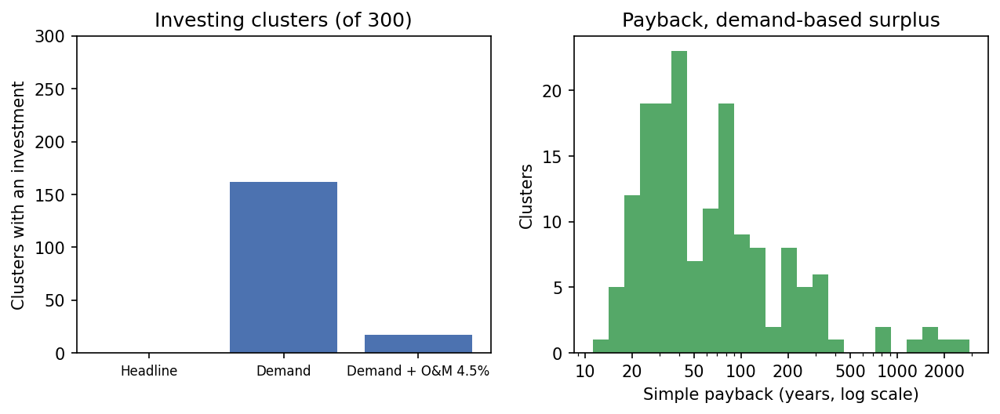

# Task 4 evaluation: PUE selection and simple payback

Copyright (c) 2026 Hao Ni. All rights reserved.

This report verifies the PUE appraisal (`dss.economics`): an independent recomputation for the demonstration cluster, the decision logic across crop mixes and surplus levels, the structured no-investment results, a batch run over randomly placed wells, the sensitivity to operation and maintenance costs, and the cold-room capacity. Headline results use the brief's parameters; other scenarios are labelled as sensitivity runs.

**Checks passed: 4 / 4**

| Check | Result | Detail |
|---|---|---|
| Engine reproduces the hand-calculated uplifts | PASS | Cold Room (5 MT): 0.00 USD/year; Grain Milling Unit: 264.07 USD/year; Solar Hybrid Dryer: 95.07 USD/year |
| Headline returns a structured decision without division by zero | PASS | status 'insufficient_surplus', payback None |
| Every no-investment path returns a status and no payback | PASS | 8 / 8 scenarios |
| Invariants hold for every cluster and scenario | PASS | 300 clusters x 3 scenarios; 0 violations |

## 1. Demonstration cluster

Harvest (area x yield x 1000 kg/t, one season per year): 10: 0.754 ha -> 5,281 kg, OTHER: 0.415 ha -> 2,073 kg.
Surplus: 0.00 kWh/day (rated, headline) and
10.69 kWh/day (demand-based).

| Asset | Daily load (kWh/day) | CAPEX (USD) | Crop compatible | Annual uplift (USD/year) | Payback if feasible (years) |
|---|---|---|---|---|---|
| Cold Room (5 MT) | 20 | 6,000 | False | 0 | - |
| Grain Milling Unit | 25 | 4,500 | True | 264.1 | 17.0 |
| Solar Hybrid Dryer | 10 | 2,500 | True | 95.07 | 26.3 |

| Scenario | Surplus (kWh/day) | Status | Asset | Net uplift (USD/year) | Payback (years) |
|---|---|---|---|---|---|
| Headline: rated consumption (brief) | 0 | insufficient_surplus | - | 0 | - |
| Sensitivity: demand-based consumption | 10.69 | invest | Solar Hybrid Dryer | 95.07 | 26.3 |
| Sensitivity: demand-based, O&M 4.5% | 10.69 | not_profitable | - | 0 | - |

**Headline.** Surplus of 0.00 kWh/day is below the daily load of every compatible asset (lowest 10 kWh/day).

**Sensitivity.** With demand-based consumption: Solar Hybrid Dryer selected: net uplift 95 USD/year, payback 26.3 years. Adding O&M of 4.5% of CAPEX (112.5 USD/year): No feasible asset has a positive annual net uplift.

**Seasonal screening** (feasibility only; monthly results are not annualised
into revenue):

| Month | Surplus, rated | Feasible, rated | Surplus, demand | Feasible, demand |
|---|---|---|---|---|
| JAN | 0 | - | 1.145 | - |
| FEB | 0 | - | 4.77 | - |
| MAR | 0 | - | 8.926 | - |
| APR | 0 | - | 13.32 | Solar Hybrid Dryer |
| MAY | 3.113 | - | 17.61 | Solar Hybrid Dryer |
| JUN | 6.279 | - | 20.78 | Solar Hybrid Dryer |
| JUL | 7.425 | - | 21.93 | Solar Hybrid Dryer |
| AUG | 4.029 | - | 18.53 | Solar Hybrid Dryer |
| SEP | 0 | - | 12.47 | Solar Hybrid Dryer |
| OCT | 0 | - | 6.197 | - |
| NOV | 0 | - | 2.072 | - |
| DEC | 0 | - | 0.1973 | - |

## 2. Decision logic across crop mixes and surplus levels

Selected asset and simple payback (years) for illustrative clusters, at surplus
levels equal to the assets' daily loads. The selection changes only when the
surplus crosses a daily load. Uplift is proportional to the harvested area, so
payback scales with 1/area: a cluster filling the whole buffer (7.07 ha)
pays back 7.07 times faster than the 1 ha values shown.

| Cluster | 0 kWh/day | 10 kWh/day | 20 kWh/day | 25 kWh/day | 50 kWh/day |
|---|---|---|---|---|---|
| Cereals & Grains (1 ha) | insufficient surplus | Dryer (19.8 y) | Dryer (19.8 y) | Mill (12.9 y) | Mill (12.9 y) |
| Orchards & Fruits (1 ha) | insufficient surplus | Dryer (11.6 y) | Cold Room (3.1 y) | Cold Room (3.1 y) | Cold Room (3.1 y) |
| Pastures & Meadows (1 ha) | no compatible crops | no compatible crops | no compatible crops | no compatible crops | no compatible crops |
| Vegetables / High-Value (1 ha) | insufficient surplus | Dryer (5.6 y) | Cold Room (2.0 y) | Cold Room (2.0 y) | Cold Room (2.0 y) |
| Fallback Field Crop (1 ha) | no compatible crops | no compatible crops | no compatible crops | no compatible crops | no compatible crops |
| Cereals + vegetables (0.5 ha each) | insufficient surplus | Dryer (8.7 y) | Cold Room (4.0 y) | Cold Room (4.0 y) | Cold Room (4.0 y) |

## 3. Structured no-investment results

| Scenario | Expected | Observed | Payback (years) | Result |
|---|---|---|---|---|
| Zero surplus | insufficient_surplus | insufficient_surplus | - | PASS |
| Surplus just below the lowest load | insufficient_surplus | insufficient_surplus | - | PASS |
| Surplus equal to the lowest load | invest | invest | 19.8 | PASS |
| Pastures only, large surplus | no_compatible_crops | no_compatible_crops | - | PASS |
| Fallback crops only | no_compatible_crops | no_compatible_crops | - | PASS |
| No parcels | no_compatible_crops | no_compatible_crops | - | PASS |
| Compatible crop with zero area | no_compatible_crops | no_compatible_crops | - | PASS |
| Tiny cereal plot, O&M 4.5% | not_profitable | not_profitable | - | PASS |

Example of the structured result returned when there is no investment:

```python
{'status': 'insufficient_surplus', 'invest': False, 'asset': None, 'surplus_kwh_day': 0.0, 'capex_usd': 0.0, 'annual_net_uplift_usd': 0.0, 'payback_years': None, 'candidates': [], 'reason': 'Surplus of 0.00 kWh/day is below the daily load of every compatible asset (lowest 10 kWh/day).'}
```

## 4. Batch run over random wells

The full chain (cluster, demand, pump, energy balance, PUE) was run for
300 wells at random agricultural parcels (seed 20261027); NASA POWER
requests are grouped by 1-degree grid cell as in the Task 3 evaluation.
Per-cluster results: [`batch_decisions.csv`](batch_decisions.csv).

Clusters with an investment: 0 of 300 under the headline, 162 with demand-based consumption and 17 when O&M of 4.5% is added.

Invariants tested: the selected asset is a candidate with the highest net uplift;
payback equals CAPEX / net uplift; no investment implies no payback; a larger
(demand-based) surplus never yields a lower net uplift than the rated surplus.

| Status | Headline: rated consumption (brief) | Sensitivity: demand-based consumption | Sensitivity: demand-based, O&M 4.5% |
|---|---|---|---|
| insufficient_surplus | 215 | 53 | 53 |
| invest | 0 | 162 | 17 |
| no_compatible_crops | 85 | 85 | 85 |
| not_profitable | 0 | 0 | 145 |

| Selected asset | Headline: rated consumption (brief) | Sensitivity: demand-based consumption | Sensitivity: demand-based, O&M 4.5% |
|---|---|---|---|
| Solar Hybrid Dryer | 0 | 162 | 17 |
| no investment | 300 | 138 | 283 |

| Scenario | Investing clusters | Payback P10 | Payback P50 | Payback P90 |
|---|---|---|---|---|
| Headline: rated consumption (brief) | 0 | - | - | - |
| Sensitivity: demand-based consumption | 162 | 22.1 | 46.8 | 243.2 |
| Sensitivity: demand-based, O&M 4.5% | 17 | 50.0 | 127.3 | 834.6 |

Seasonal screening (number of months in which at least one asset meets both
requirements):

| Months with a feasible asset | Clusters, rated | Clusters, demand |
|---|---|---|
| 0 | 289 | 90 |
| 1 | 8 | 0 |
| 2 | 2 | 8 |
| 3 | 1 | 0 |
| 4 | 0 | 24 |
| 5 | 0 | 4 |
| 6 | 0 | 31 |
| 7 | 0 | 63 |
| 8 | 0 | 43 |
| 9 | 0 | 37 |



*Batch run over random wells.*

**Which assets are reachable.** A larger pump is selected only when the
demand, and therefore the consumption, is larger. Even with demand-based
consumption the surplus of a pump configuration therefore cannot exceed
`PV_kWp x PSH x derate - t_pump x P_min`, where `P_min` is the smallest
required power that selects it. At the sunniest sampled grid cell (annual PSH
5.05), for every configuration a 150 m buffer can need:

| Pumps | P_min (kW) | Clusters in batch | Max surplus, demand-based (kWh/day) | Assets within reach |
|---|---|---|---|---|
| 1 x Tier 1 | 0 | 287 | 18.94 | Dryer |
| 1 x Tier 2 | 3.7 | 11 | 6.206 | none |
| 1 x Tier 3 | 5.5 | 0 | 4.875 | none |
| 1 x Tier 4 | 7.5 | 2 | 11.81 | Dryer |
| 2 x Tier 3 | 11 | 0 | 9.75 | none |

No pump configuration can power the Cold Room or the Mill on an annual basis, whatever the consumption assumption. The dryer is reachable by Tier 1 clusters needing at most 1.49 kW, and by 1 x Tier 4 only just above P_min, which is why every investment in the batch is a dryer.

**Additional demonstration sites.** Selected from the batch by fixed
rules and written to `demo_sites.csv`; `run_demo.py` runs them at the same
wells, so its output reproduces these rows.

| Role | Rule | Well | Crops | Area (ha) | Pumps | Headline | Demand-based |
|---|---|---|---|---|---|---|---|
| Investment | Shortest demand-based payback in the batch | (40.25284, -7.50536) | 50 | 0.4953 | 1 x Tier 1 | insufficient_surplus | Solar Hybrid Dryer (11.2 y) |
| No compatible crops | Pasture-only cluster nearest to the demonstration site | (38.17968, -8.36278) | 30 | 2.157 | 1 x Tier 1 | no_compatible_crops | no_compatible_crops |

## 5. Cold-room capacity

Following the brief's tip, the cold-room uplift is applied to the whole
compatible harvest; its 5 t capacity is not imposed as a
cap. The table shows how many full loads that harvest represents. Produce is
held for a limited period rather than a whole season, so the capacity binds
only if the harvest arrives faster than one load per storage period.

| Case | Compatible harvest (t/year) | Full 5 t loads per year | Days per load if spread over a year |
|---|---|---|---|
| Whole buffer of Vegetables / High-Value | 176.7 | 35.34 | 10.3 |
| Whole buffer of Orchards & Fruits | 84.82 | 16.96 | 21.5 |
| Largest cluster in the batch run | 84.79 | 16.96 | 21.5 |
| Median cluster in the batch run | 1.613 | 0.3226 | less than one load per year |

## Reproducibility

| Item | Value |
|---|---|
| Generated (UTC) | 2026-10-28 10:59 |
| Python | 3.10.12 |
| Platform | Linux-6.8.0-106-generic-x86_64-with-glibc2.35 |
| Git commit | ef2eb1b |
| Random seed | 20261027 |
| geopandas | 1.1.4 |
| shapely | 2.1.2 |
| pyproj | 3.7.1 |
| pyogrio | 0.13.0 |
| pandas | 2.3.3 |
| numpy | 2.2.6 |
| requests | 2.34.2 |
| matplotlib | 3.10.9 |
| MD5 nasa_power_alentejo.json | 9c5b276825e8dc5567610f1d97b03e09 |
